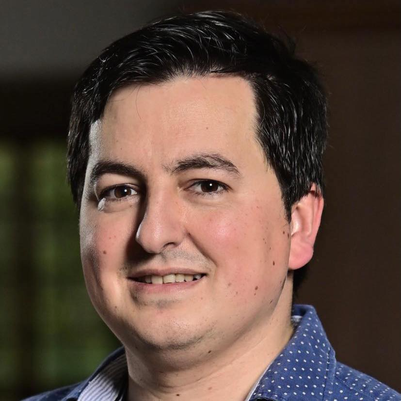
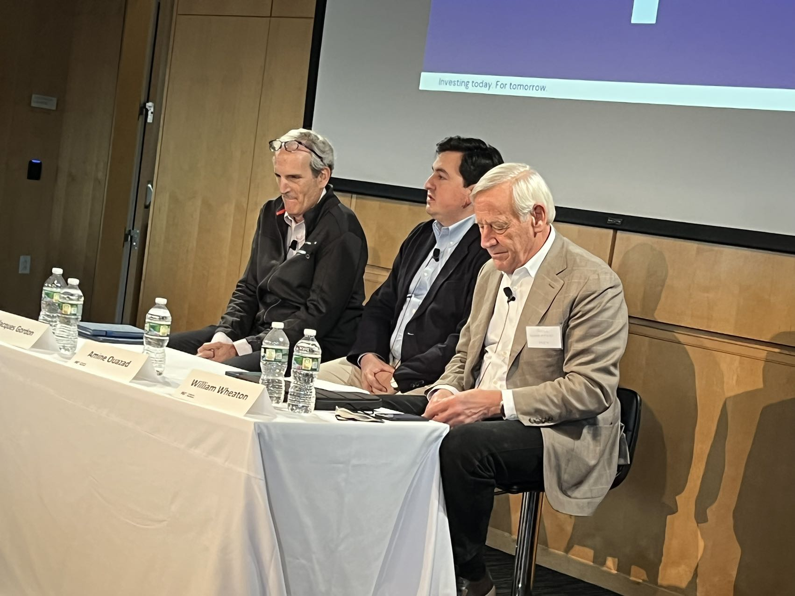
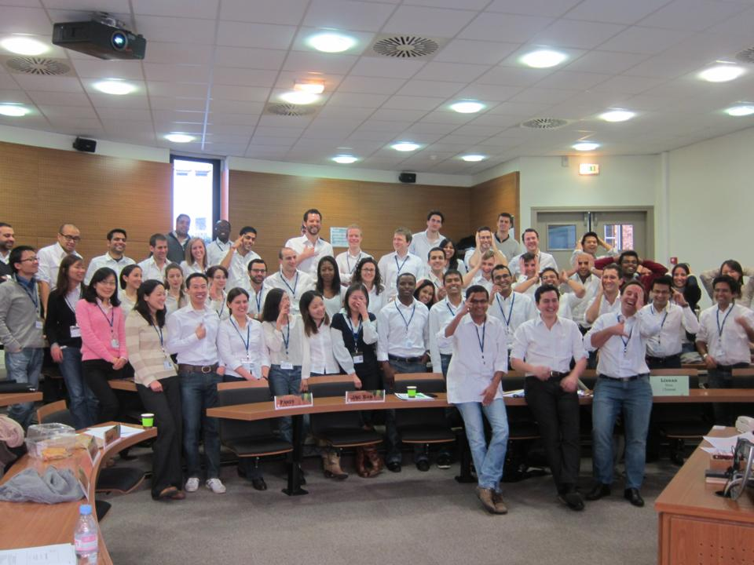

Professeur agrégé au Département d'Économie de [HEC Montréal](https://www.hec.ca/en/profs/amine.ouazad.html), Canada.

___
::: columns

:::: {.column width="80%"}
> 
 Mes recherches portent sur l'économie urbaine et immobilière. Je dirige le cursus d'économie urbaine et immobilière à HEC Montréal. 

> 
 📍 J'ai servi de nombreuses années dans le [comité scientifique](https://www.areuea.org/international) et des [comités de récompenses](https://www.areuea.org/awards-committee) de l'American Real Estate and Urban Economics Association, et le comité scientifique de l'[Urban Economics Association](https://urbannomics.org/meetings/). 

> 
 📍 Mes recherches ont été citées durant des [auditions du Congrès](https://youtu.be/c9lrud-Uaok?t=2610), à Radio Canada, CBC Radio 1, La Presse, dans le Financial Times, le Wall Street Journal, le New York Times, CBS , Bloomberg, Politico, etc. 

> 
 📍 Mes postes précédents incluent: professeur agrégé à l'École polytechnique, France, professeur agrégé à Rutgers Business School dans le New Jersey, et professeur adjoint à l'INSEAD, Fontainebleau.Je suis diplômé de l'[École polytechnique](https://www.polytechnique.edu/), de l'École des Hautes Études en Sciences Sociales (Économie de Paris), de la London School of Economics (European Doctoral Program in Quantitative Economics). 

::::

:::: {.column .headshot-col width="20%"}

::::

:::

::: columns

:::: {.column width="45%"}

::::

:::: {.column width="10%"}
\
::::

:::: {.column width="45%"}

::::

:::

